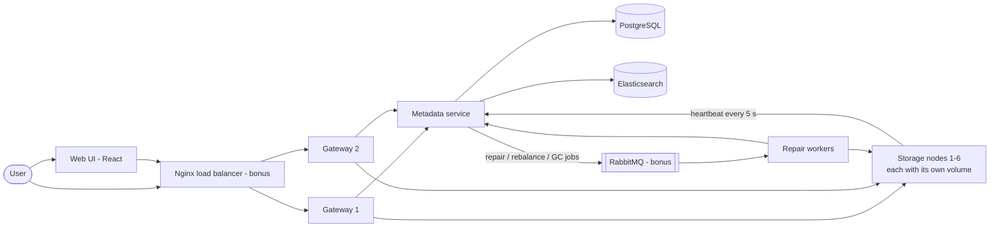
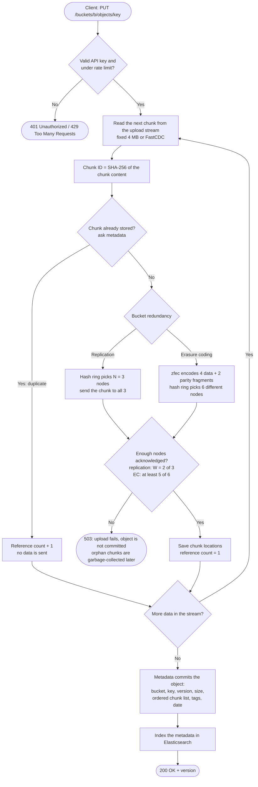
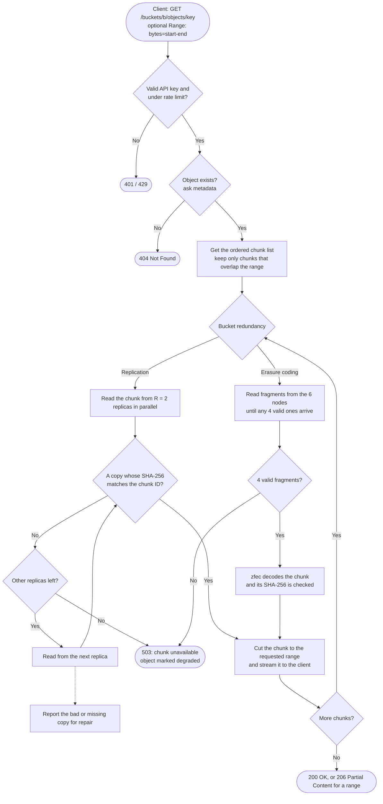
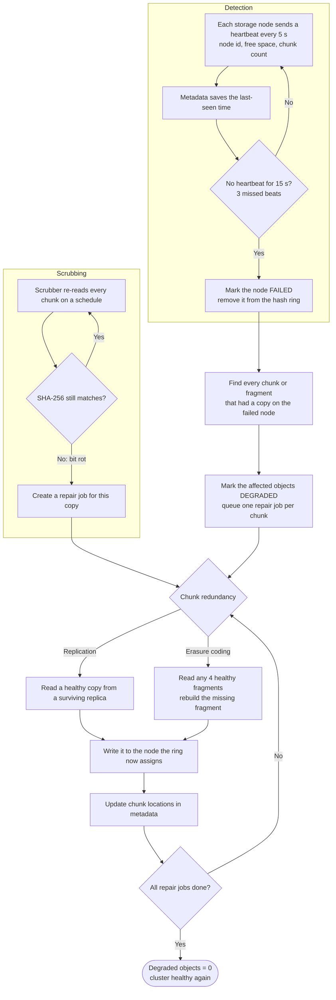

# Distributed Object Storage – Lab Guide

This guide splits the midterm into **8 phases**, one per task in the assignment. Phases 7 and 8 are the bonus tasks.
For every phase it lists:

- **What gets built:** the files and services.
- **Check it works:** the commands to run.
- **Screenshots:** what to capture, and the command that shows it.
- **In the report:** what your paragraph should explain.

At the end you will find the **3 flowcharts** the report needs, a **Word report outline**, and the **deliverables checklist**.

## Progress

| Phase | Assignment task | Status |
|---|---|---|
| 1 | Set up the environment | ✅ Done |
| 2 | Storage node module | ✅ Done |
| 3 | Metadata and placement | ✅ Done |
| 4 | Redundancy and recovery | ⬜ Next |
| 5 | API gateway | ⬜ |
| 6 | Web UI + Elasticsearch search | ⬜ |
| 7 | Load balancing and fault tolerance (bonus) | ⬜ |
| 8 | Cloud deployment (bonus) | ⬜ |

---

## How to work through a phase

1. **Build** the phase.
2. **Run** the "Check it works" commands.
3. **Take the screenshots** listed in the phase's table.
4. **Write the paragraph** in your Word report under that phase's heading. See [the report outline](#how-to-organize-the-word-report).
5. **Commit** the phase:
   ```powershell
   git add -A
   git commit -m "Phase N: <what was done>"
   git tag phase-N
   git push --follow-tags
   ```

### Taking good screenshots

- The assignment requires **full-screen** screenshots. Press **`Win + PrtScn`** to capture the whole screen. The image is saved to `Pictures\Screenshots`.
- Before you capture, maximize the window, clear old output with `cls`, and make the text bigger (`Ctrl` + `+` in the terminal) so it is easy to read in the report.
- Name each file after its figure number in this guide, for example `P3-07-chunking-comparison.png`, and keep them in `docs\screenshots\phase-3\`.
- Right after each screenshot, write one note to yourself about what it shows. Writing the report paragraph later is then much faster.
- In PowerShell, always type **`curl.exe`**, not `curl`. Plain `curl` is a different PowerShell command.

---

## Architecture (the finished system)



| Service | Folder | Built in | Job |
|---|---|---|---|
| storage-node (4, then 6) | `storage_node/` | Phase 2 | Stores chunks named by their SHA-256 on its own volume, checks the hash on every read, sends heartbeats |
| metadata | `metadata/` | Phase 3 | PostgreSQL tables for buckets, objects, chunk lists, reference counts and nodes. Runs the consistent hashing ring and detects failed nodes |
| repair-worker | `repair_worker/` | Phase 4 | Rebuilds lost chunks, runs the scrubber, rebalances data, garbage-collects unused chunks |
| gateway | `gateway/` | Phase 5 | S3-like REST API, authentication, rate limiting, chunking, quorum, erasure coding |
| ui | `ui/` | Phase 6 | React web interface |
| PostgreSQL, Elasticsearch | Docker images | Phases 3 and 6 | Metadata store and search |
| Nginx, RabbitMQ, Prometheus, Grafana | `deploy/` | Phase 7 | Bonus |

Code used by several services (chunking, hash ring, erasure coding) goes in `common/`.

**Ports on your PC:** storage nodes `8001`–`8006`, gateway `8080`, metadata `9000`, UI `5173`, Elasticsearch `9200`, RabbitMQ admin `15672`, Prometheus `9090`, Grafana `3000`.

### Project folders

```
lab-dest/
├── storage_node/        Phase 2  storage node service + Dockerfile
├── common/              Phase 3+ shared code: chunking, hash ring, erasure coding
├── metadata/            Phase 3  metadata service + Dockerfile
├── repair_worker/       Phase 4  repair, scrubber, rebalance, garbage collection
├── gateway/             Phase 5  public API
├── ui/                  Phase 6  React app
├── deploy/              Phase 7-8 nginx, prometheus, grafana, kubernetes files
├── scripts/             dataset generator, demo scripts, benchmarks, CLI
├── benchmarks/results/  benchmark output (CSV + charts)
├── tests/               pytest tests + Postman collection
├── docs/                this guide, flowcharts, screenshots
└── docker-compose.yml
```

---

## Phase 1 – Set up the environment ✅

**Goal:** have every tool installed, a Git repository, and one separate disk (Docker volume) per storage node.

**Done:** Python 3.12 with a virtual environment in `.venv`, a Git repository on branch `main`, Docker Desktop, Node.js, and a Docker volume for each storage node.
Kubernetes is also running: Docker Desktop in kind mode, Kubernetes v1.36.1.
**Repository:** https://github.com/abed0srour/lab-dest (first commit `ac2520d`, Phases 1–2).

| Fig | Screenshot | How to show it |
|---|---|---|
| 1.1 | Installed tool versions | `py -3.12 --version; git --version; docker --version; kubectl version --client; node --version` |
| 1.2 | Virtual environment active, with packages installed | `.\.venv\Scripts\Activate.ps1`, then `pip list` (the prompt shows `(.venv)`) |
| 1.3 | GitHub repository page | Browser, after the first push |
| 1.4 | Kubernetes running | Docker Desktop → Kubernetes page (green), plus `kubectl get nodes` in a terminal |
| 1.5 | One volume per storage node | `docker volume ls` |
| 1.6 | Project structure | VS Code Explorer panel with the folders expanded |

**In the report, explain:**

- What you installed and why:
  - Python 3.12 and a virtual environment, so the project's packages stay separate from the rest of the PC.
  - Git and GitHub, for version control.
  - Docker, so each storage node runs in its own container like a separate machine.
  - Kubernetes, for deployment later.
- Why each node gets its own Docker volume: each one acts as that node's private disk, so nodes never share data by accident.

---

## Phase 2 – Storage node module ✅

**Goal:** a service that stores chunks named by their SHA-256 hash and refuses to return corrupted data.

**What was built:** [storage_node/app.py](../storage_node/app.py), [storage_node/Dockerfile](../storage_node/Dockerfile), [docker-compose.yml](../docker-compose.yml) (4 nodes), [tests/test_storage_node.py](../tests/test_storage_node.py), [scripts/demo_storage_node.ps1](../scripts/demo_storage_node.ps1).

| Method | Path | What it does |
|---|---|---|
| PUT | `/chunks/{sha256}` | Stores a chunk. Rejected with **400** if the content's hash does not match the name |
| GET | `/chunks/{sha256}` | Returns the chunk after re-checking its hash. **409** if the chunk is corrupted |
| HEAD | `/chunks/{sha256}` | Tells whether the chunk exists, and its size |
| DELETE | `/chunks/{sha256}` | Removes the chunk |
| GET | `/chunks` | Lists every chunk on this node (used later by repair) |
| GET | `/health` | Node id, free space, chunk count |

- **Disk layout:** chunks are stored at `/data/chunks/ab/cd/<hash>`, where `ab` and `cd` are the first 4 characters of the hash. This keeps any one folder from holding thousands of files.
- **Atomic writes:** each chunk is written to a temporary file and then renamed into place, so a crash can never leave a half-written chunk.
- **Heartbeat:** every 5 seconds, each node sends its id, free space and chunk count to the metadata service. That service is built in Phase 3, so until then each node logs a warning that its heartbeats are failing.

**Check it works:**

```powershell
docker compose up -d --build
docker compose ps
powershell -ExecutionPolicy Bypass -File scripts\demo_storage_node.ps1
.\.venv\Scripts\python.exe -m pytest -v
```

| Fig | Screenshot | How to show it |
|---|---|---|
| 2.1 | Storage node code | `storage_node/app.py` open in VS Code |
| 2.2 | Automatic API documentation | Browser: http://localhost:8001/docs |
| 2.3 | 4 nodes running and healthy | `docker compose ps` |
| 2.4 | Storing, reading, checking and deleting a chunk | Demo script, top part |
| 2.5 | Corrupted chunk rejected | Demo script, "bit rot" part, plus `docker compose logs storage-node-1 --tail 5` |
| 2.6 | All tests pass | `.\.venv\Scripts\python.exe -m pytest -v` |
| 2.7 | Heartbeats arriving | **Take this in Phase 3**, once the metadata service exists: `.\.venv\Scripts\python.exe scripts\cli.py nodes` (same as Fig 3.2) |

**In the report, explain:**

- **Content addressing:** a chunk's name is the SHA-256 of its bytes. Identical data always gets the same name, and changing even one bit gives a different name. That is how corruption is detected.
- Why the node checks the hash on every read.
- The atomic write.
- The heartbeat contents.
- What each HTTP status code means.

---

## Phase 3 – Metadata and placement

**Goal:**

- Split files into chunks.
- Remember which chunks make up each object.
- Decide which nodes store each chunk.
- Store identical chunks only once.

**What was built:**

| File | What it does |
|---|---|
| [common/chunking.py](../common/chunking.py) | Fixed 4 MB chunks, and FastCDC (min 1 MB, average 4 MB, max 16 MB). FastCDC is fed 64 MB windows so it works on streams |
| [common/ring.py](../common/ring.py) | Consistent hashing ring, 128 virtual nodes per node. A chunk goes to the next 3 distinct nodes clockwise from its hash |
| [common/client.py](../common/client.py) | Write path (chunk → ask metadata → write 3 copies → commit) and read path (fetch each chunk, check its hash). Reused by the gateway in Phase 5 |
| [metadata/app.py](../metadata/app.py) | Metadata service (FastAPI + PostgreSQL) on port **9000**: heartbeats, buckets, placement and dedup check (`/plan`), object commit and versions, reference counts, garbage collection, `/stats` |
| [scripts/cli.py](../scripts/cli.py) | Command-line tool: `nodes`, `mb`, `buckets`, `put`, `put-dir`, `get`, `ls`, `stat`, `rm`, `stats` |
| [scripts/generate_datasets.py](../scripts/generate_datasets.py) | Creates the two workloads in `datasets/` |
| [scripts/bench_chunking.py](../scripts/bench_chunking.py), [scripts/bench_placement.py](../scripts/bench_placement.py) | Benchmarks; results in `benchmarks/results/*.csv` |
| [scripts/demo_phase3.ps1](../scripts/demo_phase3.ps1) | Runs the whole Phase 3 demo for the screenshots |
| `tests/test_ring.py`, `tests/test_chunking.py`, `tests/test_cluster.py` | 15 new tests (22 in total) |

**Database tables** (created automatically when the metadata service starts):

| Table | Holds |
|---|---|
| `buckets` | Name, redundancy mode (replication or erasure coding), creation date |
| `objects` | Bucket, key, version, size, chunking method, tags, creation date |
| `object_chunks` | The ordered list of chunk hashes for each object version |
| `chunks` | Hash, size, reference count |
| `chunk_locations` | Which nodes hold each chunk |
| `nodes` | Node id, URLs, last heartbeat, free space, chunk count |

**Datasets** (`python scripts\generate_datasets.py`, about 3 minutes):

- `datasets/small/`: 5,000 files, 121.8 MB, of which 539 are exact duplicates.
- `datasets/large/`: 10 disk images, 1.80 GB in total. `disk-05` to `disk-09` are new versions of `disk-00` to `disk-04`.

**Measured results:**

| Test | Fixed 4 MB | FastCDC |
|---|---|---|
| Large workload: space saved by dedup | 5.2% | **38.7%** |
| Small workload: space saved by dedup | 11.1% | 11.1% (each small file is a single chunk) |
| Insert 10 bytes into a 109 MB file: chunks changed | 15 of 28 (57 MB stored again) | **1 of 29 (1.8 MB)** |

| Scenario | Ring: copies moved | Modulo: copies moved | Ring: primary changed | Modulo: primary changed | Ideal |
|---|---|---|---|---|---|
| Add a node (4 → 5) | **20.1%** | 39.8% | 20.8% | 79.3% | 20% |
| Remove a node (5 → 4) | **18.2%** | 40.4% | 20.9% | 80.8% | 20% |

With 1 virtual node per node, the busiest node holds 27% more than average. With 128 it holds only **4.7%** more.

**Check it works:**

```powershell
docker compose up -d --build
.\.venv\Scripts\python.exe -m pytest -v
powershell -ExecutionPolicy Bypass -File scripts\demo_phase3.ps1
```

> To start again from an empty cluster: `docker compose down -v`, then `docker compose up -d`. This deletes every stored chunk and the whole database.

| Fig | Screenshot | How to show it |
|---|---|---|
| 3.1 | PostgreSQL + metadata service running | `docker compose ps` |
| 3.2 | All 4 nodes sending heartbeats (also counts as Fig 2.7) | `.\.venv\Scripts\python.exe scripts\cli.py nodes` |
| 3.3 | Database tables | `docker compose exec postgres psql -U dos -d dos -c "\dt"` |
| 3.4 | Datasets generated | `.\.venv\Scripts\python.exe scripts\generate_datasets.py` output |
| 3.5 | Upload and download a 194 MB file; SHA-256 identical | Demo script, step 3 |
| 3.6 | Object metadata with its ordered chunk list and 3 nodes per chunk | Demo script, step 4 |
| 3.7 | Deduplication: refcount 2 → 1 → chunk removed from 3 nodes | Demo script, step 5 |
| 3.8 | Fixed-size vs FastCDC on the cluster | Demo script, step 6 |
| 3.9 | Fixed-size vs FastCDC on both workloads + edit test | `.\.venv\Scripts\python.exe scripts\bench_chunking.py` |
| 3.10 | Data moved when adding or removing a node; balance by vnodes | `.\.venv\Scripts\python.exe scripts\bench_placement.py` |
| 3.11 | 5,000 small files uploaded, with dedup | `cli.py mb small`, then `cli.py put-dir small datasets\small`, then `cli.py stats --bucket small` |
| 3.12 | Chunks spread evenly over the 4 nodes | `cli.py nodes` (after Fig 3.11) |
| 3.13 | All tests pass | `.\.venv\Scripts\python.exe -m pytest -v` |

**In the report, explain:**

- Fixed-size vs content-defined chunking, and why FastCDC handles inserted bytes better.
- What metadata is stored, and why PostgreSQL. Searching by prefix, size, date and tag is plain SQL.
- How the ring works, with a drawing: a circle, virtual nodes, a chunk hash walking clockwise. Virtual nodes spread the data evenly.
- Your measured movement percentages compared with the expected ~20%.
- How reference counting makes deletion safe.

---

## Phase 4 – Redundancy and recovery

**Goal:** keep data available when nodes fail or disks corrupt data.

**What gets built:**

1. **Replication** with N = 3 copies, write quorum W = 2, read quorum R = 2, all configurable. Because W + R = 4 > N = 3, every read overlaps at least one node from the latest write.
2. **Erasure coding** with Reed–Solomon 4 + 2 using `zfec`, chosen per bucket (a bucket is created with `redundancy=ec`).
3. **Scale to 6 storage nodes**, so each of the 6 fragments lands on a different node. With only 4 nodes, two nodes would hold 2 fragments each, and losing one of them would lose 2 fragments at once.
4. **Failure detection.** A node with no heartbeat for 15 s (3 missed beats) is marked **FAILED** and removed from the ring.
5. **Repair worker:**
   - Finds every chunk that had a copy on the failed node.
   - Marks those objects as degraded.
   - Rebuilds each copy on another node:
     - replication: copy from a surviving replica;
     - erasure coding: read any 4 fragments and rebuild the missing one.
6. **Scrubber.** On a schedule, it re-reads every chunk. A chunk with the wrong hash (bit rot) is replaced from a healthy copy.
7. **Benchmark**, `scripts/bench_redundancy.py`: storage overhead and repair traffic for both schemes on both workloads.

**Results to expect:**

| | Replication (3 copies) | Erasure coding (4 + 2) |
|---|---|---|
| Storage overhead | 3.0× | 1.5× |
| Failures survived | 2 | 2 |
| Data read to rebuild one lost piece | 1 copy (1× its size) | 4 fragments (4× the fragment size) |
| Small files | Fine | Each tiny file becomes 6 tiny fragments, so many more requests and metadata rows |

| Fig | Screenshot | How to show it |
|---|---|---|
| 4.1 | 6 nodes running; one replicated bucket and one EC bucket | `docker compose ps` + bucket list |
| 4.2 | Quorum: upload succeeds with 1 of a chunk's 3 nodes down, fails with 2 down | Quorum demo script |
| 4.3 | Failed node detected | `docker compose stop storage-node-3`, wait 15 s, then `/nodes` shows FAILED |
| 4.4 | Repair running and finished | `docker compose logs -f repair-worker`, until degraded objects reach 0 |
| 4.5 | Data still correct after the failure | Download, then `Get-FileHash` matches the original |
| 4.6 | EC object readable with 2 nodes down, fails with 3 down (before repair) | Stop nodes one at a time and download |
| 4.7 | Scrubber fixes bit rot | Corrupt a chunk on disk, then the scrubber log shows it detected and repaired |
| 4.8 | Replication vs EC on both workloads | `bench_redundancy.py` table |

**In the report, explain:**

- The quorum rule W + R > N.
- How Reed–Solomon k + m works: any k of the k + m pieces rebuild the data.
- The failure-detection timeout trade-off. Too short marks healthy but slow nodes as failed; too long leaves data unprotected for longer.
- The repair flowchart.
- Your comparison table, with a conclusion: EC uses half the space but needs more reads and more CPU to repair, and it is a poor fit for tiny files.

---

## Phase 5 – API gateway

**Goal:** an S3-like public API that hides chunks and nodes from the user.

**What gets built:** a FastAPI service in `gateway/`.

| Method | Path | Purpose |
|---|---|---|
| PUT | `/buckets/{bucket}` | Create a bucket (choose `replication` or `ec`) |
| GET | `/buckets` | List buckets |
| PUT | `/buckets/{bucket}/objects/{key}` | Upload (streamed, so large files never sit fully in memory). Tags go in the `X-Tags` header, for example `type=video,project=lab` |
| GET | `/buckets/{bucket}/objects/{key}` | Download. `Range: bytes=0-1023` returns **206 Partial Content** |
| HEAD | `/buckets/{bucket}/objects/{key}` | Metadata only |
| DELETE | `/buckets/{bucket}/objects/{key}` | Delete (chunk reference counts go down) |
| GET | `/buckets/{bucket}/objects?prefix=` | List objects |
| GET | `/search?prefix=&min_size=&max_size=&after=&before=&tag=` | Search |
| GET | `/cluster/status` | Nodes, free space, chunks per node, degraded objects |

- **Authentication:** an `X-API-Key` header. A missing or wrong key returns **401**.
- **Rate limiting:** for example 100 requests per minute per key. Over the limit returns **429**.
- **Tests:** `tests/test_gateway.py` (pytest), a Postman collection in `tests/postman/`, and curl examples.
- **Workload benchmark**, `scripts/bench_workloads.py`: upload and download all 5,000 small files and all 10 large files, then report throughput (MB/s, files/s) and latency.

| Fig | Screenshot | How to show it |
|---|---|---|
| 5.1 | All endpoints | Browser: http://localhost:8080/docs |
| 5.2 | Create and list buckets | curl |
| 5.3 | Upload a large file (time, MB/s) | curl with `-w "%{time_total}"` |
| 5.4 | Byte-range download returns 206 with a `Content-Range` header | `curl.exe -r 0-1023 -i ...` |
| 5.5 | List, metadata (HEAD), delete | curl |
| 5.6 | Search by prefix, size, date, tag | curl |
| 5.7 | Cluster status | `curl.exe http://localhost:8080/cluster/status` |
| 5.8 | No or wrong API key returns 401 | curl without the header |
| 5.9 | Rate limit returns 429 | Loop of requests |
| 5.10 | Tests pass | `pytest -v` |
| 5.11 | Postman collection run | Postman Runner window |
| 5.12 | Small vs large workload results | `bench_workloads.py` table |

**In the report, explain:**

- How the gateway turns one upload into chunks, placement and quorum writes. Refer to the write-path flowchart.
- How a range request reads only the chunks it needs.
- How authentication and rate limiting work.
- The workload results: small files are limited by the number of requests, large files by bandwidth.

---

## Phase 6 – Web UI + Elasticsearch

**Goal:** a browser interface for files and cluster health, and search backed by Elasticsearch.

**What gets built:**

- A React app (Vite) in `ui/` with three pages:
  - **Browser:** buckets and objects, upload with a progress bar, download, delete.
  - **Search:** prefix, size, date and tag filters, answered by Elasticsearch.
  - **Cluster:** a health card per node, a chunks-per-node chart, and a repair progress bar.
- A single-node Elasticsearch in `docker-compose.yml`. The metadata service indexes every upload and delete.
- ⚠️ `npm install` plus the Elasticsearch image download about 1 GB in total, so do this phase on a fast connection.

| Fig | Screenshot | How to show it |
|---|---|---|
| 6.1 | Bucket and object browser | http://localhost:5173 |
| 6.2 | Uploading a file (progress bar) | UI |
| 6.3 | Downloading a file | UI + the file in `Downloads` |
| 6.4 | Search page with filters and results | UI |
| 6.5 | The data really is in Elasticsearch | `curl.exe "http://localhost:9200/objects/_search?q=key:report*"` |
| 6.6 | Cluster dashboard, all healthy, chunk distribution chart | UI |
| 6.7 | Dashboard during a failure: node red, repair progress moving | Stop a node, then watch the UI |
| 6.8 | Dashboard after repair: 0 degraded objects | UI |

**In the report, explain:**

- How the UI talks to the gateway.
- Why search uses Elasticsearch instead of PostgreSQL: full-text and combined filters stay fast on many objects.
- What the dashboard shows during a failure.

---

## Phase 7 – Bonus: load balancing and fault tolerance

**What gets built:**

- **Nginx** in front of **2 gateway instances.** Each response carries an `X-Gateway-Id` header, so you can see requests alternate between them.
- **RabbitMQ** queues for `repair`, `rebalance` and `gc` jobs, with 2 or more repair workers sharing the jobs.
- **Kubernetes StatefulSet** for storage nodes, with persistent volumes, a **liveness** probe (`/health`) and a **readiness** probe, so a crashed node restarts automatically.
- A **replicated metadata store:** PostgreSQL primary + streaming replica, or a 3-member etcd cluster.
- **Prometheus + Grafana:** throughput, latency, disk usage per node, degraded objects, repair rate.

| Fig | Screenshot | How to show it |
|---|---|---|
| 7.1 | Requests alternate between 2 gateways | `curl.exe -i` several times, showing `X-Gateway-Id` |
| 7.2 | One gateway stopped, requests still succeed | `docker compose stop gateway-1`, then curl |
| 7.3 | RabbitMQ queues and consumers | http://localhost:15672 |
| 7.4 | Two workers sharing repair jobs | Worker logs side by side |
| 7.5 | StatefulSet, pods and volumes | `kubectl get statefulset,pods,pvc` |
| 7.6 | Deleted pod comes back automatically; probes configured | `kubectl delete pod storage-node-2`, then `kubectl get pods -w` and `kubectl describe pod` |
| 7.7 | Metadata replication working | Replica status query, or a failover test |
| 7.8 | Prometheus targets all UP | http://localhost:9090/targets |
| 7.9 | Grafana dashboard | http://localhost:3000 |

---

## Phase 8 – Bonus: cloud deployment

**What gets built:**

- A Dockerfile for each service: storage node, metadata, gateway, repair worker, UI.
- Docker Compose for local testing.
- Kubernetes manifests in `deploy/k8s/`.
- A deployment on a cloud provider. **Azure for Students** gives free credit with a university email; check the current offer.
- **Auto-scaling** for the gateway (Horizontal Pod Autoscaler on CPU).
- A rebalancing demo: adding a storage node moves about 1/(n+1) of the chunks onto it.
- ⚠️ **Delete the cloud cluster as soon as your screenshots are done**, so it doesn't use up your credit.

| Fig | Screenshot | How to show it |
|---|---|---|
| 8.1 | Dockerfiles and built images | VS Code + `docker images` |
| 8.2 | Cluster in the cloud console | Azure / GCP / AWS portal |
| 8.3 | Everything running in the cloud | `kubectl get all` |
| 8.4 | App reachable on a public address | UI in the browser with the URL visible |
| 8.5 | Gateway auto-scaling under load | `kubectl get hpa -w` while a load script runs |
| 8.6 | New storage node triggers rebalancing | `kubectl scale statefulset storage-node --replicas=7`, then the rebalance logs and the new node's chunk count rising |

---

## Flowcharts (required in the report)

To turn a flowchart into an image for Word:

1. Copy everything inside its code block, without the ` ```mermaid ` line or the closing ` ``` `.
2. Paste it into https://mermaid.live.
3. Choose **Actions → PNG** and insert the image into Word.

GitHub also draws these diagrams automatically when you open this file on github.com.

### Write path



### Read path



### Failure and repair path (including scrubbing)



> Update a flowchart if the final code ends up working differently from what it shows. The report must describe what the system really does.

---

## How to organize the Word report

### Formatting (set this up before you start writing)

- **Headings:** use the built-in styles from *Home → Styles*: **Heading 1** for chapters, **Heading 2** for sections. They are needed for step 2.
- **Table of contents:** *References → Table of Contents*. Right-click it → *Update Field* before you submit.
- **Figure captions:** right-click a picture → *Insert Caption* → label "Figure" → tick *Include chapter number*. Word numbers figures for you, for example "Figure 6.3". Then add *References → Insert Table of Figures* after the table of contents.
  - The figure numbers in this guide (3.7, 4.2, …) are only for naming your screenshot files. Let Word number the captions.
- **Pattern for every screenshot:**
  1. A paragraph **before** it: what you are doing and why.
  2. The screenshot at full page width (*Layout Options → In line with text*).
  3. The caption.
  4. One or two sentences **after** it: what the result proves.
- **Body text:** Calibri or Times New Roman 12 pt, 1.15 line spacing, justified.
- **Commands and code:** Consolas 10 pt, or *Insert → Text Box* with a light grey fill.
- **Benchmark numbers:** put them in Word tables (*Insert → Table*). Make bar charts with *Insert → Chart*, or paste the charts the benchmark scripts produce.
- **Page layout:** page numbers in the footer, and the course name in the header.

### Outline

| # | Chapter | Contents | Screenshots / figures |
|---|---|---|---|
| — | Cover page | University logo, faculty, course, project title, your name and ID, instructor, date | — |
| — | Table of contents + list of figures | Generated automatically | — |
| 1 | Introduction | The problem, the objectives (copy the list from the assignment), tools used | — |
| 2 | System architecture | Architecture diagram, services table, database tables, technology choices | Architecture diagram |
| 3 | System workflow | 3.1 Write path, 3.2 Read path, 3.3 Failure and repair path. Each flowchart with a paragraph that walks through it | The 3 flowcharts |
| 4 | Phase 1 – Environment | Objective, steps taken, screenshots, result | Figs 1.1–1.6 |
| 5 | Phase 2 – Storage node | Same structure | Figs 2.1–2.7 |
| 6 | Phase 3 – Metadata and placement | Same structure | Figs 3.1–3.10 |
| 7 | Phase 4 – Redundancy and recovery | Same structure | Figs 4.1–4.8 |
| 8 | Phase 5 – API gateway | Same structure | Figs 5.1–5.12 |
| 9 | Phase 6 – Web UI | Same structure | Figs 6.1–6.8 |
| 10 | Phase 7 – Load balancing and fault tolerance (bonus) | Same structure | Figs 7.1–7.9 |
| 11 | Phase 8 – Cloud deployment (bonus) | Same structure | Figs 8.1–8.6 |
| 12 | Workload evaluation | 12.1 The two datasets. 12.2 Fixed vs FastCDC. 12.3 Deduplication savings. 12.4 Data moved when adding or removing a node. 12.5 Replication vs EC: storage overhead and repair traffic. 12.6 Throughput and latency, small vs large files | Tables and charts from `benchmarks/results/` |
| 13 | Challenges and solutions | For example: the slow internet connection (downloads retried in the background); EC 4 + 2 needed 6 nodes | — |
| 14 | Conclusion | What works, what you learned, what you would improve | — |
| A | Appendix A – How to run | The setup and run commands | — |
| B | Appendix B – Repository | GitHub link and the list of delivered files | — |

**Each phase chapter uses the same 4 sections:**

1. **Objective:** one or two sentences, taken from the assignment.
2. **Implementation:** the paragraph explaining the steps you took. The assignment requires this.
3. **Testing and screenshots:** the figures, each with its before-and-after text.
4. **Results and observations:** numbers, problems you hit, how you solved them.

---

## Deliverables checklist

- [ ] Word report: full-screen screenshots and an explanatory paragraph for every phase, the 3 flowcharts, workload results for both workloads
- [ ] Source code: GitHub link, plus a zip of the repository
- [ ] Dockerfiles, `docker-compose.yml`, Kubernetes and Nginx/Prometheus configuration files
- [ ] Test scripts: pytest tests, the Postman collection, demo scripts
- [ ] Dataset generator script: deliver the script, not the gigabytes of generated data. It recreates the data
- [ ] Benchmark results: `benchmarks/results/*.csv` and the charts
